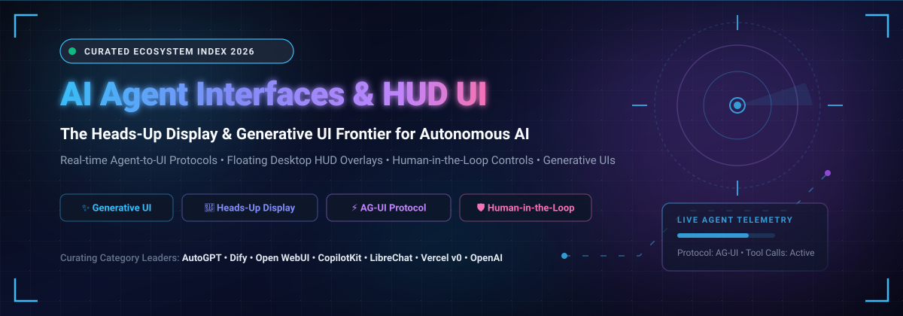

  

# 🚀 Awesome AI Agent Interfaces & Heads-Up Display (HUD) UI

  
  
  
  
  

---

## 🎯 Overview & Scope

A curated directory and developer guide to **AI Agent Interfaces**, **Heads-Up Display (HUD) Overlays**, **Generative UI Protocols (AG-UI)**, **Streaming Frontends**, and **Human-in-the-Loop Approval Workspaces**.

Autonomous AI agents require specialized user interfaces beyond static chat bubbles:
- **Heads-Up Display (HUD) Overlays**: Floating desktop/web telemetry monitoring agent reasoning traces, tokens, tool invocations, and session quotas.
- **Generative UI & Dynamic Widgets**: On-the-fly rendering of interactive React/Vue components synthesized directly from LLM tool outputs (MCP-UI, json-render).
- **Agent-User Interaction Protocols (AG-UI)**: Bidirectional streaming protocols standardizing state synchronization, real-time interrupts, and user steering.
- **Human-in-the-Loop (HITL) Controls**: Approval gates, interrupt hooks, and interactive parameter adjustment before agent tool actions execute.

---

## 📊 Sector Overview & Market Dynamics

The global conversational AI and agentic software market is valued between **$14B and $18B in 2026** (scaling past $50B+ by 2030 at a 25%–45% CAGR), driven by rapid enterprise migration from static text bots to autonomous multi-agent systems.

The sector is **moderately to highly fragmented** rather than winner-take-all: while hyperscalers (OpenAI, Microsoft, Google) provide foundational frontier models and base APIs, the user interface layer remains open and competitive across niche desktop HUDs, sovereign local-first frontends, generative UI protocols, and customizable open-source developer toolkits.

---

## 📑 Table of Contents

- [🏢 SaaS & Hosted Platforms](#-saas--hosted-platforms)
- [💻 Open-Source GitHub Projects](#-open-source-github-projects)
- [📈 Star History](#-star-history)
- [🤝 How to Contribute](#-how-to-contribute)
- [💖 Support & Sponsorship](#-support--sponsorship)
- [⚖️ Disclaimer](#-disclaimer)

---

## 🏢 SaaS & Hosted Platforms

*Sorted by Company Size / Valuation (Descending)*

| Platform / Product | Company Size / Valuation | Starting Paid Tier Pricing | Free Tier Limits / Evaluation Trial | Description |
| :--- | :--- | :--- | :--- | :--- |
| **[ChatKit / OpenAI Agent Builder](https://openai.com)** | **$852B Valuation** ($13.1B+ ARR) | Pay-as-you-go via OpenAI API (Build Tier requires $5 minimum credit balance) | **Free UI toolkit & 1 GB storage** included free per account/mo for uploaded assets (underlying API model tokens require pay-as-you-go credits) | Managed UI platform, ChatKit web components, and visual workflow interface for building and embedding custom agents with tool-calling. |
| **[Vercel v0](https://v0.dev)** | **$9.3B Valuation** ($340M+ ARR) | **$20/month** (Core Pro) / **$30/user/mo** (v0 Team) | **Free plan capped at 7 messages/day** (~$5 starting generation credits; lacks team workspaces and private data opt-out) | Cloud AI generative user interface system that synthesizes production-ready React, Tailwind CSS, and shadcn/ui components from prompts. |
| **[Poe (Quora)](https://poe.com)** | **$500M Valuation** (Backed by $75M a16z round) | **$4.99/month** (Entry tier) / **$19.99/mo** (Pro tier with 1M compute pts) | **Free daily compute points allocation** refreshed every 24 hours (sufficient for standard models; flagship/vision models rapidly exhaust points) | Cloud multi-model AI interface and bot-creation platform with compute-point balancing, creator revenue-sharing, and multi-LLM orchestration. |
| **[Dify Cloud](https://dify.ai)** | **$180M Valuation** ($30M Series Pre-A) | **$59/month** (Professional Plan, billed annually at $590/yr) | **Sandbox Free Tier**: 1 workspace member, 10 apps, 5MB–50MB vector storage, and a one-time allocation of 200 message credits (BYOK supported) | Hosted LLM application studio and agentic canvas with visual DAG workflow builders, embeddable chat widgets, and RAG knowledge bases. |
| **[Botpress Cloud](https://botpress.com)** | **$120M Valuation** ($45M+ funding, $10M+ ARR) | **$150/month** (Plus Plan billed annually, or $189/mo monthly) | **Free Forever Tier**: Includes up to 100 conversations/month, 3 team seats, 3 autonomous bots/agents, and community support | Enterprise conversational agent platform offering visual canvas designers, customizable webchat widgets, and omnichannel integrations. |
| **[Dust.tt](https://dust.tt)** | **$100M–$250M Valuation** ($40M Series B, $7M+ ARR) | **$29/seat/month** (Pro Plan, billed monthly) | **Free Evaluation Seat**: One-time lifetime allocation of 500 query credits (does not renew; paid Pro grants 8,000 credits/seat/mo) | Collaborative multiplayer workspace for building company AI assistants with live enterprise data connections (Slack, Notion, Google Drive) and agent citations. |
| **[Stack AI](https://stack-ai.com)** | **$75M+ Valuation** (Acquired by Asana; $20M funding) | Custom Enterprise pricing (starter tiers previously offered from $199/month) | **Free Forever Tier**: Up to 500 workflow runs/month, 2 active projects, 1 user seat, and community support | No-code enterprise AI workflow and agent automation suite providing white-label chat forms, document ingestion, and enterprise integrations. |
| **[CopilotKit Cloud](https://copilotkit.ai)** | **$27M Total Funding** (Series A led by Glilot & NFX) | **$49/month** (Cloud Pay-As-You-Go, includes 10,000 interactions) | **Developer Edition (Free)**: 1,000 cloud interactions/month, 1 developer seat, local non-production license (MIT core library is unlimited self-hosted) | Managed cloud infrastructure and developer portal for embedding in-app AI co-pilots, generative UI widgets, and shared agent state into web apps. |
| **[TypingMind](https://typingmind.com)** | **$4M–$9M Est. Value** ($1M–$1.5M+ ARR, bootstrapped) | **$39 one-time** (Standard) / **$79 one-time** (Premium) / **$83/mo** (Teams) | **Free Web Layout Tier**: Test UI without cloud sync (chat history is not saved across sessions; periodic upgrade prompts appear every few minutes) | Commercial-grade web frontend for LLMs and agents featuring custom agent personas, Artifacts, MCP server support, and bring-your-own-key (BYOK) privacy. |

---

## 💻 Open-Source GitHub Projects

*Sorted by GitHub Stars (Descending)*

| Repository | GitHub Stars | License | Primary Focus & Highlights |
| :--- | :--- | :--- | :--- |
| **[Significant-Gravitas/AutoGPT](https://github.com/Significant-Gravitas/AutoGPT)** |  | `MIT` | Autonomous AI agent architecture featuring frontend agent execution monitors, visual task decomposition graphs, and browser interaction controls. |
| **[langgenius/dify](https://github.com/langgenius/dify)** |  | `Apache-2.0` | Comprehensive open-source LLM app and agent development platform featuring a visual DAG workflow studio, embeddable web chat widgets, and RAG pipelines. |
| **[open-webui/open-webui](https://github.com/open-webui/open-webui)** |  | `BSD-3-Clause` | Feature-rich self-hosted AI interface supporting Ollama, OpenAI-compatible APIs, web search, RAG pipelines, Python tool functions, and voice/video calls. |
| **[browser-use/browser-use](https://github.com/browser-use/browser-use)** |  | `MIT` | Web automation agent interface allowing AI agents to navigate web apps with interactive live view, visual DOM bounding-box overlays, and human steering. |
| **[ChatGPTNextWeb/NextChat](https://github.com/ChatGPTNextWeb/NextChat)** |  | `MIT` | Lightweight, cross-platform web and desktop interface for LLMs and agents supporting Next.js, WebAssembly, and zero-configuration one-click deployments. |
| **[lobehub/lobe-chat](https://github.com/lobehub/lobe-chat)** |  | `MIT` | Modern AI agent workspace and chat UI framework featuring plugin/MCP marketplaces, Artifacts, text-to-speech, visual recognition, and multi-model support. |
| **[Mintplex-Labs/anything-llm](https://github.com/Mintplex-Labs/anything-llm)** |  | `MIT` | All-in-one desktop and Docker AI workspace featuring custom autonomous agents, no-code agent builder, RAG document chat, and embeddable web widgets. |
| **[LibreChat-AI/LibreChat](https://github.com/LibreChat-AI/LibreChat)** |  | `MIT` | Complete multi-provider AI chat platform featuring autonomous Agents, Code Interpreter, Artifacts, Model Context Protocol (MCP) server integration, and RBAC. |
| **[streamlit/streamlit](https://github.com/streamlit/streamlit)** |  | `Apache-2.0` | Fastest way to build data and AI agent web applications in pure Python with streaming chat elements, status containers, and interactive forms. |
| **[janhq/jan](https://github.com/janhq/jan)** |  | `AGPL-3.0` | Offline-first desktop AI interface and local OpenAI-compatible server built for running open-weight models, custom assistants, and MCP tools with privacy. |
| **[gradio-app/gradio](https://github.com/gradio-app/gradio)** |  | `Apache-2.0` | Widely adopted Python framework for rapidly creating interactive web UIs, multimodal chat interfaces, and agent demos shareable via public links. |
| **[CopilotKit/CopilotKit](https://github.com/CopilotKit/CopilotKit)** |  | `MIT` | Open-source React framework for embedding in-app AI co-pilots, agentic chat sidebars, and generative UI components backed by LangGraph, CrewAI, or Mastra. |
| **[SillyTavern/SillyTavern](https://github.com/SillyTavern/SillyTavern)** |  | `AGPL-3.0` | Extensible local-first power-user frontend for conversational AI personas, TTS/STT voice interfaces, Live2D avatars, and custom script extensions. |
| **[mckaywrigley/chatbot-ui](https://github.com/mckaywrigley/chatbot-ui)** |  | `MIT` | Clean, modern web chat interface built with Next.js and Supabase supporting multi-model switching, custom assistants, and prompt libraries. |
| **[vercel/ai](https://github.com/vercel/ai)** |  | `Apache-2.0` | The AI SDK by Vercel: TypeScript hooks (`useChat`, `useObject`) and streaming generative UI primitives for React, Next.js, Vue, and Svelte agent frontends. |
| **[ag-ui-protocol/ag-ui](https://github.com/ag-ui-protocol/ag-ui)** |  | `MIT` | Event-based protocol standardizing bidirectional real-time communication, state synchronization, generative UI, and human-in-the-loop steering between agents and frontends. |
| **[vercel-labs/json-render](https://github.com/vercel-labs/json-render)** |  | `MIT` | Declarative, JSON-driven generative UI engine enabling autonomous agents to safely stream and render custom React layouts without arbitrary code execution. |
| **[pipecat-ai/pipecat](https://github.com/pipecat-ai/pipecat)** |  | `BSD-2-Clause` | Framework for real-time multimodal voice and conversational agent UIs with ultra-low latency WebRTC streaming and speech interruption controls. |
| **[thesysdev/openui](https://github.com/thesysdev/openui)** |  | `Apache-2.0` | Generative UI SDK enabling developers and AI agents to generate, prototype, and render interactive UI components on the fly in plain HTML/React. |
| **[livekit/agents](https://github.com/livekit/agents)** |  | `Apache-2.0` | Real-time multimodal voice and video agent framework with interactive frontend playgrounds, live speech interruption, and WebRTC streaming HUDs. |
| **[botpress/botpress](https://github.com/botpress/botpress)** |  | `AGPL-3.0` | Visual bot and autonomous agent development platform featuring conversational flow builders, custom action executions, and webchat embeds. |
| **[assistant-ui/assistant-ui](https://github.com/assistant-ui/assistant-ui)** |  | `MIT` | TypeScript/React component library engineered specifically for AI chat and agent interfaces with streaming markdown, tool-call accordions, and branch switches. |
| **[Chainlit/chainlit](https://github.com/Chainlit/chainlit)** |  | `Apache-2.0` | Python framework for building conversational agent interfaces with visual thought steps, intermediate tool outputs, data elements, and Copilot widgets. |
| **[enricoros/big-AGI](https://github.com/enricoros/big-AGI)** |  | `MIT` | Personal AI suite and multi-agent interface featuring persona beams, side-by-side model execution, multimodal voice interaction, and developer workflows. |
| **[e2b-dev/fragments](https://github.com/e2b-dev/fragments)** |  | `Apache-2.0` | Open-source sandbox UI template for running full-stack code and web applications generated live by AI agents inside isolated micro-VM sandboxes. |
| **[MCP-UI-Org/mcp-ui](https://github.com/MCP-UI-Org/mcp-ui)** |  | `MIT` | Generative UI renderer for the Model Context Protocol (MCP) displaying sandboxed, interactive web UI components returned directly from MCP servers. |
| **[langchain-ai/agent-chat-ui](https://github.com/langchain-ai/agent-chat-ui)** |  | `MIT` | Official Next.js interface from LangChain for interacting with LangGraph agents with live tool-call inspection, execution timelines, and interrupt resumes. |
| **[jazzenchen/agent-hud-open](https://github.com/jazzenchen/agent-hud-open)** |  | `MIT` | Heads-Up Display (HUD) desktop overlay for monitoring autonomous coding agents (Claude Code, Codex, Aider), tracking active tokens, quotas, and sessions at a glance. |

---

## 📈 Star History

---

## 🤝 How to Contribute

Contributions are welcome from frontend engineers, AI researchers, and agent developers! 

1. 🍴 **Fork the repository**.
2. 🌿 **Create a descriptive feature branch** (`git checkout -b add-my-agent-hud`).
3. 📝 **Add or edit entries in `README.md`**:
   - Maintain the table format and schema.
   - For SaaS: include specific starting pricing tier, specific free tier limits, and estimated company valuation/size.
   - For Open-Source: include the repository link, star badge (`style=social&color=white` linking to `/stargazers`), license, and a concise 1–2 sentence description.
4. 🚀 **Submit a Pull Request** with a brief summary of the addition or update.

---

## 💖 Support & Sponsorship

If you find this curated ecosystem directory helpful for your AI agent interfaces, generative UI workflows, or research, please consider supporting the project:

- ⭐ **Star this repository** to help others discover it.
- 🍴 **Fork and share** with your AI and frontend engineering teams.
- ☕ **Sponsor or buy a coffee**: [Sponsor Dashboard on GitHub](https://github.com/sponsors/ishandutta2007)

Thank you for supporting open-source AI tooling and human-centric agent interfaces! 🙏

---

## ⚖️ Disclaimer

- This is an independent **community-curated index** — listings do not constitute commercial endorsement.
- Generative UI components, MCP-rendered widgets, and agent code execution hooks execute dynamic payloads from LLM outputs and require strict iframe sandboxing, Content Security Policy (CSP), and XSS sanitization.
- Self-hosted chat and agent interfaces exposed over networks require proper authentication, RBAC, and API key isolation.
